<div align="center">


<br/>


[](https://github.com/Picsou06/zipguard/actions)


<br/><br/>


<br/><br/>



</div>


## 🎬 Le scan en direct

Le mécanisme, joué en boucle : une archive minuscule qui prétend peser des gigaoctets, et
ZipGuard qui la refuse **avant** d'écrire le moindre octet.

<div align="center">



<br/><br/>



</div>

### Et la vraie sortie, sans retouche

Celle ci n'est pas une capture d'écran faite à la main : elle est **produite en exécutant
réellement la commande**, par [`scripts/build-terminal.py`](scripts/build-terminal.py).
Un README qui recopie une sortie à la main finit toujours par mentir.

<div align="center">



</div>

L'archive du dessus est le cas intéressant : **son propre ratio est de 1.0x**, parfaitement
innocent. Le danger est un niveau plus bas, dans une entrée appelée `notes.txt` qui est en
fait une archive. C'est exactement ce qu'un scanner non récursif laisserait passer.


## ✨ C'est quoi ?

**ZipGuard** est une boîte à outils **éducative et défensive** autour des *bombes de
décompression* (zip bombs). Elle répond à une question simple :

> « Comment un programme peut il ouvrir une archive inconnue sans se faire piéger ? »

Le dépôt n'embarque **aucune bombe prête à l'emploi**. Il contient de la mesure, de la
défense, et un cours. Tout ce qui pourrait servir d'arme en est volontairement absent.


## 🧠 Ce que tu vas apprendre

| Module | Question | Réponse courte |
| :-- | :-- | :-- |
| [Comment ça marche](docs/01-comment-ca-marche.md) | Pourquoi 3 Ko deviennent 10 Go ? | Le ratio de compression des données répétitives |
| [Prévention](docs/02-prevention.md) | Comment s'en protéger ? | Huit garde fous + mesure pendant la lecture |
| [Anatomie](docs/03-anatomie.md) | Comment le code est organisé ? | Un adaptateur par format, un seul jeu de seuils |

> 📘 **Dossier complet en PDF**, mis en page avec la charte graphique :
> [`docs/pdf/ZipGuard-Documentation.pdf`](docs/pdf/ZipGuard-Documentation.pdf)
> — régénérable avec `./scripts/build-pdf.sh` (pandoc + un navigateur Chromium).

---

## 🚀 Prise en main

```bash
git clone https://github.com/Picsou06/zipguard.git
cd zipguard/zipguard.app
pip install .

# avec le support 7z, qui demande une dépendance externe
pip install ".[7z]"
```

### Inspecter une archive (le cœur défensif)

```bash
zipguard scan une_archive.zip
```

```
  ZipGuard · rapport d'inspection
  ────────────────────────────────────────────────────────────────────

   ✅  SÛRE   rapport.zip
       zip · tailles déclarées · profondeur 0

   entrées               2
   taille compressée     468.9 KiB
   taille décompressée   468.8 KiB
   ratio                 1.0x        ░░░░░░░░░░░░░░░░░░░░░░  seuil 100.0x
   plus grosse entrée    468.8 KiB
   archives imbriquées   0

  ────────────────────────────────────────────────────────────────────
```

Un ratio trop élevé, une taille démesurée, trop d'entrées ou une archive imbriquée
dangereuse ? Le verdict passe à **DANGEREUSE**, l'extraction est refusée, et le code de
sortie vaut `1`.

### Les commandes

| Commande | Ce qu'elle fait |
| :-- | :-- |
| `zipguard scan ARCHIVE` | Inspecte et rend un verdict, sans rien écrire sur le disque |
| `zipguard extract ARCHIVE DEST` | Extrait une archive jugée sûre, en recomptant chaque octet |
| `zipguard demo FICHIER` | Fabrique une démonstration bornée, en `zip` ou `tar.gz` |
| `zipguard serve` | Expose le scanner en petit service HTTP local |
| `zipguard bench` | Mesure le temps que met chaque garde fou à trancher |
| `zipguard formats` | Liste les formats pris en charge |

Toutes les commandes d'analyse acceptent `--json`, et les seuils se règlent en ligne de
commande : `--max-ratio`, `--max-total-mb`, `--max-entry-mb`, `--max-entries`,
`--max-depth`, plus `--max-extract-mb`, `--min-free-mb` et `--allow-links` pour
l'extraction.

### Codes de sortie

| Code | Signification |
| :-: | :-- |
| `0` | Opération réussie, archive jugée sûre |
| `1` | Archive jugée dangereuse, ou extraction refusée |
| `2` | Erreur d'utilisation de la ligne de commande |
| `3` | Erreur d'exécution : fichier introuvable, illisible, plafond de démo |

Une archive introuvable ne se déguise donc pas en verdict dangereux : un script peut
distinguer **un refus** d'**une panne**.

### Brancher dans une chaîne d'intégration

```bash
zipguard scan livraison.zip --json | jq '.safe, .reasons'
```

```json
{
  "schema_version": 1,
  "tool": "zipguard",
  "version": "2.1.0",
  "archive": "livraison.zip",
  "safe": false,
  "verdict": "DANGEREUSE",
  "reasons": ["Archive imbriquée dangereuse — notes.txt : Ratio de compression anormal : 1027.2x > 20.0x."],
  "stats": { "kind": "zip", "entries": 2, "ratio": 1.0, "nested_archives": 1 },
  "children": [ { "safe": false, "stats": { "name": "notes.txt", "kind": "zip", "ratio": 1027.22 } } ],
  "limits": { "max_ratio": 20.0 }
}
```

Le champ `schema_version` est un contrat : il changera si la forme change, pour qu'un
script branché dessus sache quand il doit être relu.

### Démonstration bornée (illustrer le ratio, sans danger)

```bash
zipguard demo samples/demo.zip --mb 10
zipguard demo samples/demo.tar.gz --format tar.gz --mb 10
```

Archive **plafonnée à 100 Mo**, non imbriquée, qui se décompresse exactement à la taille
annoncée. Elle montre la puissance de la compression des données répétitives sans jamais
pouvoir servir d'arme.

## 🐳 Docker

```bash
# développement (code monté en lecture seule)
docker compose -f compose.dev.yaml run --rm zipguard scan /samples/demo.zip

# production (conteneur durci, lecture seule, sans privilèges)
docker compose -f compose.prod.yaml build
```


## 📦 Neuf formats, un seul jeu de seuils

Le scanner ne connaît aucun format : il parle à un adaptateur commun. Un `tar.xz` passe
donc exactement les mêmes contrôles qu'un `zip`.

| Format | Ce que ZipGuard peut croire |
| :-- | :-- |
| `zip` | Un manifeste complet, vérifié ensuite pendant l'extraction |
| `7z` | Un manifeste, via la dépendance optionnelle `py7zr` |
| `tar`, `tar.gz`, `tar.bz2`, `tar.xz` | Rien : les tailles sont **mesurées** en lisant |
| `gz`, `bz2`, `xz` | Rien : un flux simple, mesuré lui aussi |

> **Le format est reconnu par sa signature, jamais par son extension.** Une bombe renommée
> en `notes.txt` est traitée comme une bombe.

### Le piège du dénominateur

Diviser la taille décompressée par la **somme des tailles compressées annoncées** paraît
naturel, et c'est une erreur. Dans une bombe à *entrées recouvrantes*, plusieurs entrées du
répertoire central pointent vers le même bloc compressé : la somme est gonflée autant de
fois qu'il y a de références, donc le ratio apparent est divisé d'autant.

Une archive de **28 Ko promettant 20 Mo** passait ainsi pour sûre, avec un ratio affiché de
50x là où la réalité était 692x. ZipGuard plafonne désormais le dénominateur par la taille
réelle du fichier sur le disque, qui ne ment pas.

Pour les formats sans manifeste, ZipGuard change de méthode mais pas de règle. Un `tar` ne
déclare pas de taille compressée par entrée, et le pied de page `gzip` annonce une taille
*modulo 4 Gio*, donc mensongère par construction au delà. La seule valeur digne de
confiance est celle que l'on compte soi même : l'inventaire se fait derrière un compteur
qui coupe au seuil, ce qui transforme **l'inventaire lui même en garde fou**.


## 🛡️ Les huit garde fous

<div align="center">

| # | Garde fou | Champ | Quand il agit |
| :-: | :-- | :-- | :-- |
| 1 | Taille décompressée totale plafonnée | `max_total_bytes` | inspection |
| 2 | Taille par entrée plafonnée | `max_entry_bytes` | inspection + écriture |
| 3 | Ratio de compression maximal | `max_ratio` | inspection |
| 4 | Nombre d'entrées maximal | `max_entries` | inspection |
| 5 | Profondeur d'imbrication maximale | `max_depth` | inspection récursive |
| 6 | Budget d'inspection des imbriquées | `max_nested_scans` | inspection récursive |
| 7 | Quota d'octets réellement écrits | `max_extract_bytes` | écriture |
| 8 | Marge d'espace disque libre exigée | `min_free_bytes` | écriture |

</div>

Trois d'entre eux sont nouveaux, et chacun bouche un trou précis :

- **`max_depth` ne se contente plus de refuser l'imbrication** : ZipGuard descend vraiment
  dans les archives filles et rend l'arbre complet des verdicts. Quand la profondeur
  interdit de descendre, le contenu est déclaré *invérifiable*, donc refusé — un défenseur
  ne fait pas confiance à ce qu'il n'a pas pu lire.
- **`max_nested_scans`** borne le travail total. Sans lui, une archive contenant dix mille
  archives vides suffirait à monter un déni de service : par le travail, pas par la taille.
- **`max_extract_bytes` et `min_free_bytes`** s'appliquent pendant l'écriture. Le verdict
  ne suffit pas, parce qu'un manifeste peut mentir : chaque octet écrit est recompté, et
  un dépassement **annule toute l'extraction**.

L'extraction est **tout ou rien**. L'archive est d'abord recopiée dans un dossier privé, et
c'est cette copie qui est inspectée puis extraite : le fichier ne peut plus changer entre
le verdict et l'écriture. Tout est ensuite écrit dans un dossier de préparation, et rien
n'arrive dans la destination tant que la dernière entrée n'est pas passée. Un échec ne
touche donc jamais aux fichiers qui s'y trouvaient déjà.

Tous les chemins sont validés *avant* la première écriture : la protection Zip Slip traite
les trois pièges classiques (chemin absolu, lettre de lecteur Windows, remontée par deux
points), les entrées en double sont refusées, tout comme un fichier qui prendrait la place
d'un dossier existant. Les liens symboliques sont refusés par défaut ; avec
`--allow-links`, seuls ceux dont la cible descend sous leur propre dossier, sans `..` ni
chemin absolu, sont recréés. Les liens physiques ne le sont jamais.

Détails et justifications dans [docs/02-prevention.md](docs/02-prevention.md).


## 🌐 Mode service

```bash
zipguard serve --port 8723
curl --data-binary @suspect.zip http://127.0.0.1:8723/scan | jq .safe
```

| Route | Réponse |
| :-- | :-- |
| `GET /health` | État du service et version |
| `GET /limits` | Les seuils réellement appliqués |
| `POST /scan` | L'archive en octets bruts, le verdict en JSON |

Chaque envoi est analysé dans un **processus jetable**. Un service qui déballe des archives
inconnues dans son propre processus se fait tuer par la première qui épuise la mémoire ou
tourne trop longtemps ; ici le dégât est plafonné à un worker perdu, et un délai dépassé
devient une réponse `504`.

L'écoute est sur la **boucle locale par défaut**, pas sur toutes les interfaces : un service
pareil ne s'expose pas au réseau sans que quelqu'un l'ait décidé. L'envoi est plafonné et
refusé sur la seule base de son en tête `Content-Length`, donc avant d'avoir lu un octet,
et le fichier reçu ne survit jamais à la requête.

Trois garde fous protègent le service lui même :

| Option | Défaut | Contre quoi |
| :-- | :-- | :-- |
| `--read-timeout` | 30 s | Un client qui envoie son corps au compte goutte (`408`) |
| `--max-concurrent` | 4 | Cent envois simultanés, donc cent workers (`503` au delà) |
| `--max-memory-mb` | 1000 | Une analyse qui fait gonfler la mémoire : verdict DANGEREUSE |

Le plafond mémoire s'appuie sur `RLIMIT_AS` et ne s'applique qu'au worker, sous Linux et
macOS ; `0` le désactive.


## ⏱️ Banc d'essai

```bash
zipguard bench
```

```
  cas                       garde fou           format    verdict           temps          lu
  ---------------------------------------------------------------------------------------------
  benigne.zip               aucun               zip       SÛRE            5.65 ms      35.0 o
  ratio.zip                 ratio               zip       REFUSÉE         0.58 ms     3.8 MiB
  entrees.zip               max_entries         zip       REFUSÉE         9.56 ms     500.0 o
  imbriquee.zip             imbrication         zip       REFUSÉE         7.18 ms     3.9 KiB
  imbriquee-profondeur.zip  max_depth           zip       REFUSÉE         0.17 ms     3.9 KiB
  mesure.tar.gz             ratio_mesure        tar.gz    REFUSÉE         6.91 ms     3.8 MiB
  lecture-coupee.tar.gz     plafond_de_lecture  tar.gz    REFUSÉE         3.50 ms   490.0 KiB
  flux.txt.gz               flux_compresse      gz        REFUSÉE         5.07 ms     3.8 MiB
  recouvrement.zip          recouvrement        zip       REFUSÉE         4.18 ms    19.1 MiB
  ---------------------------------------------------------------------------------------------
  12 cas, 45.2 ms au total, 0 verdict(s) inattendu(s)
```

La ligne à lire est `lecture-coupee.tar.gz` : **490 Kio lus sur 3,8 Mio** avant que le
plafond ne coupe. C'est toute la thèse du projet en un chiffre — refuser sans avoir tout
déballé.

Le corpus est synthétique, borné, et reconstruit à chaque lancement : aucune archive ne
dépasse un mégaoctet compressée, aucune ne s'imbrique au delà d'un niveau. Le banc **mesure
une défense, il ne fabrique pas une arme**. Au passage, il vérifie que chaque garde fou rend
bien le verdict attendu, ce qui en fait un test de bout en bout autant qu'un chronomètre.


## 👥 L'équipe

<div align="center">



<br/>

<table>
<tr>
<td align="center" width="50%">
<a href="https://github.com/Picsou06">
<br/>
<b>Evan</b> · <code>@Picsou06</code>
</a><br/>
<sub>Architecture & moteur de mesure</sub>
</td>
<td align="center" width="50%">
<a href="https://github.com/CodeByHaamza">
<br/>
<b>Hamza Karrouchi</b> · <code>@CodeByHaamza</code>
</a><br/>
<sub>Extraction sûre & pédagogie</sub>
</td>
</tr>
</table>

<table>
<tr>
<td>

</td>
<td>

</td>
</tr>
</table>

</div>

## 🗺️ Répartition du travail

Un partage pensé pour être **équilibré et complémentaire** : chacun porte une moitié
cohérente du projet, de la conception à la vérification.

| Domaine | Evan · `@Picsou06` | Hamza · `@CodeByHaamza` |
| :-- | :--: | :--: |
| Modèle de menace & conception | ● | ○ |
| Moteur de mesure (ratio, seuils, verdict) | ● | ○ |
| Interface en ligne de commande | ● | ○ |
| Intégration Docker & CI/CD | ● | ○ |
| Extraction plafonnée & protection Zip Slip | ○ | ● |
| Générateur de démonstration borné | ○ | ● |
| Suite de tests & couverture | ○ | ● |
| Documentation pédagogique (`docs/`) | ○ | ● |

<sub>● responsable principal · ○ relecture et co-conception. Chaque ligne a été relue à deux, d'où le co-auteur systématique sur les commits. Les modules de la version 2 — adaptateurs de format, inspection récursive, quota d'extraction, mode service, banc d'essai — ont été construits à quatre mains.</sub>


## 💡 Idées d'évolution

Les six pistes de la version 1 sont **toutes livrées** :

| Piste | État |
| :-- | :-- |
| Support `tar.gz` et `7z` avec les mêmes seuils | ✅ neuf formats, plus `tar.bz2`, `tar.xz`, `gz`, `bz2`, `xz` |
| Sortie JSON pour brancher le scanner dans une CI | ✅ `--json` sur toutes les commandes, avec `schema_version` |
| Inspection récursive bornée jusqu'à `max_depth` | ✅ arbre complet des verdicts, budget d'inspection |
| Quota disque réel pendant l'extraction | ✅ octets recomptés + marge de disque libre, nettoyage au dépassement |
| Mode service analysant un flux dans un worker isolé | ✅ API HTTP locale, processus jetable, délai plafonné |
| Banc d'essai mesurant le temps avant refus | ✅ onze cas, un par garde fou, verdicts vérifiés |

La suite, pour qui veut continuer :

- 🟢 **Signatures de confiance** : accepter une allowlist d'archives connues par empreinte.
- 🟢 **Rapport SARIF** pour afficher les refus directement dans l'onglet Sécurité de GitHub.
- 🟡 **Inspection en flux** d'une archive distante, sans jamais la poser sur le disque.
- 🟡 **Détection des archives chiffrées**, qu'aucun seuil ne peut inspecter honnêtement.
- 🔴 **Bac à sable système** (seccomp, cgroups) autour du worker d'analyse.

## 🧪 Tests

```bash
cd zipguard.app
pip install -r requirements-dev.txt
pytest -q                         # 190 tests
pytest -q --cov=zipguard          # avec la couverture
ruff check .                      # style et erreurs courantes
```

La CI rejoue cette suite sur Python 3.10 à 3.13, exige au moins 85 % de couverture et
l'affiche dans le résumé du job, vérifie le style, puis construit l'image Docker.

### Publier une version

Le workflow [`release.yml`](.github/workflows/release.yml) publie sur PyPI à chaque
étiquette `vX.Y.Z`, par **publication de confiance** : aucun jeton à stocker. À faire une
seule fois :

1. Sur PyPI, ajouter un *trusted publisher* GitHub pour ce dépôt : workflow `release.yml`,
   environnement `pypi`.
2. Dans les réglages du dépôt, créer l'environnement `pypi`.

Ensuite, monter la version dans `pyproject.toml` et `__init__.py`, puis :

```bash
git tag v2.1.0 && git push origin v2.1.0
```

Le workflow refuse une étiquette qui ne correspond pas à la version du paquet.

## 📋 Journal et sécurité

- [`CHANGELOG.md`](CHANGELOG.md) — ce qui a changé, et pourquoi.
- [`SECURITY.md`](SECURITY.md) — comment signaler une faille, et surtout **ce que ZipGuard
  ne promet pas** : archives chiffrées, limite du format 7z, coût de lecture d'un `tar`.

## ⚖️ Éthique

Ce projet est **défensif et pédagogique**. Il explique un mécanisme d'attaque uniquement
pour apprendre à le détecter et à le neutraliser. Aucune charge offensive n'est fournie :
le générateur de démonstration est plafonné à 100 Mo, non imbriqué, et se décompresse
exactement à la taille annoncée. À utiliser sur tes propres systèmes et dans un cadre
d'apprentissage.

<div align="center">


</div>
